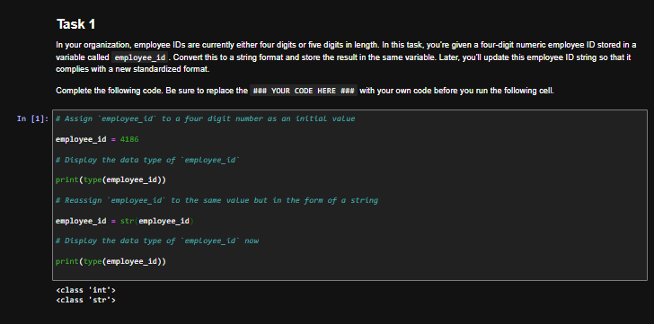
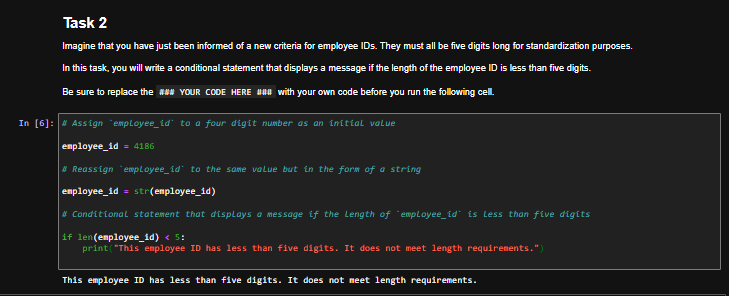
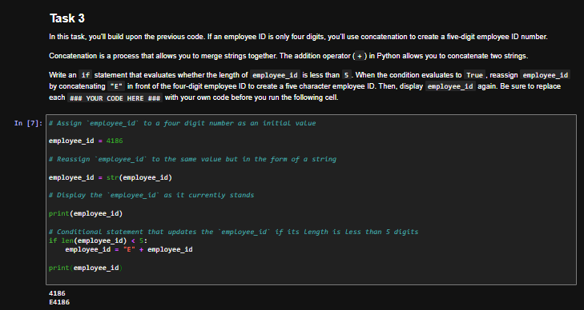
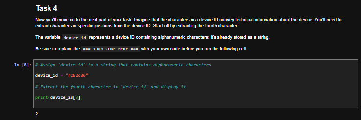
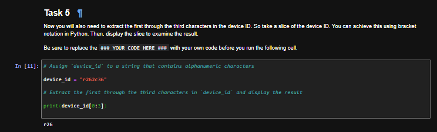
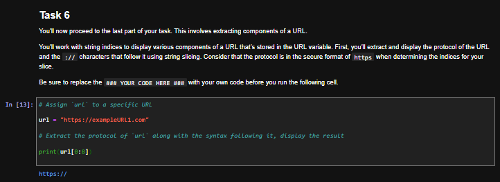
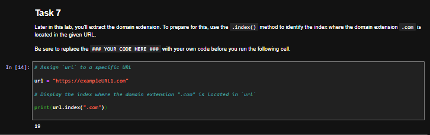
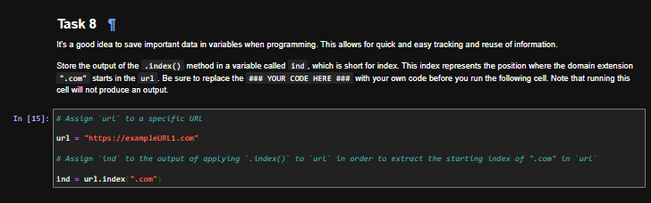
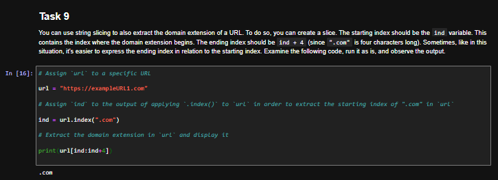
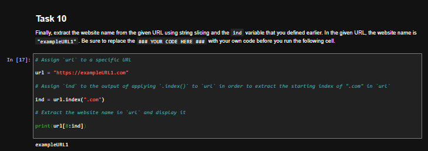

# Python Strings: Employee IDs, Device IDs, and URL Parsing

## Summary

In this lab from the Google Cybersecurity Certificate (Automate Cybersecurity Tasks with Python), I used Python string methods to standardize a short employee ID, extract characters from a device ID, and pull the protocol, website name, and domain extension out of a URL. The employee ID, device ID, and URL are sample data provided by the course.

## Tools Used

- Python 3
- Jupyter Notebook (course lab environment)

## Skills Demonstrated

- Converting a number to a string with `str()` and checking types with `type()`
- Measuring string length with `len()`
- String concatenation with the `+` operator
- Using a length check in an `if` statement
- String indexing
- String slicing
- Finding a substring with `.index()` and reusing that index in a slice

## Part 1: Standardizing an Employee ID

Employee IDs in this scenario are either four or five digits long, and they need to be standardized to five characters.

**Task 1: convert the ID to a string.** The ID starts as the integer `4186`. `type()` first reports `<class 'int'>`. After `str()` stores the same value as a string, `type()` reports `<class 'str'>`. String methods in the later tasks require this conversion.

```python
employee_id = 4186

print(type(employee_id))

employee_id = str(employee_id)

print(type(employee_id))
```



**Task 2: check the length.** IDs must be five characters long. `len(employee_id)` is 4, so the condition is true and the warning prints.

```python
employee_id = 4186
employee_id = str(employee_id)

if len(employee_id) < 5:
    print("This employee ID has less than five digits. It does not meet length requirements.")
```



**Task 3: concatenate a prefix.** When the ID is shorter than five characters, `"E"` is added to the front. The cell prints `4186` before the update and `E4186` after it.

```python
employee_id = 4186
employee_id = str(employee_id)

print(employee_id)

if len(employee_id) < 5:
    employee_id = "E" + employee_id

print(employee_id)
```



## Part 2: Extracting Characters from a Device ID

The device ID `"r262c36"` is already a string. Characters in specific positions can carry information about the device.

**Task 4: index the fourth character.** Python counts from 0, so the fourth character is at index 3. The output is `2`.

```python
device_id = "r262c36"

print(device_id[3])
```



**Task 5: slice the first three characters.** A slice uses a start and a stop, and the stop is not included, so `[0:3]` returns positions 0, 1, and 2. The output is `r26`.

```python
device_id = "r262c36"

print(device_id[0:3])
```



## Part 3: Extracting Parts of a URL

The URL `"https://exampleURL1.com"` is used to practice pulling out the protocol, the domain extension, and the website name. The same kind of parsing is useful when reviewing URLs in logs or phishing reports.

**Task 6: slice the protocol.** `https://` is 8 characters, so `[0:8]` prints `https://`.

```python
url = "https://exampleURL1.com"

print(url[0:8])
```



**Task 7: find where `.com` starts.** `.index(".com")` returns `19`, the position of the `.` in `.com`. It does not extract the text yet; that index is used for slicing in later tasks.

```python
url = "https://exampleURL1.com"

print(url.index(".com"))
```



**Task 8: store the index.** The same `.index()` result is saved in `ind` so it can be reused. The cell produces no output.

```python
url = "https://exampleURL1.com"

ind = url.index(".com")
```



**Task 9: slice the domain extension.** Starting at `ind` and stopping at `ind+4` takes the four characters of `.com`. The output is `.com`.

```python
url = "https://exampleURL1.com"
ind = url.index(".com")

print(url[ind:ind+4])
```



**Task 10: extract the website name.** The name starts right after `https://` at index 8 and stops where `.com` begins. `url[8:ind]` prints `exampleURL1`.

```python
url = "https://exampleURL1.com"
ind = url.index(".com")

print(url[8:ind])
```



## Key Takeaways

- IDs often arrive as numbers, but length checks and concatenation only work on strings, so converting with `str()` is a first step toward standardizing identifiers.
- A length check with `len()` and a prefix such as `"E"` can bring a short employee ID up to a required format.
- Indexing and slicing pull meaningful pieces out of a device ID, such as a character at a known position or a short prefix.
- `.index()` finds where a substring such as `".com"` starts, and that position can drive slices that extract a URL's protocol, website name, and domain extension — the same kind of parsing used when reviewing URLs in logs or phishing reports.
- The stop index in a slice is not included: `[0:3]` returns three characters, and `[ind:ind+4]` returns the four characters of `.com`.
- `.index()` raises an error if the substring is not in the string; this lab uses a URL that is known to contain `.com`.
